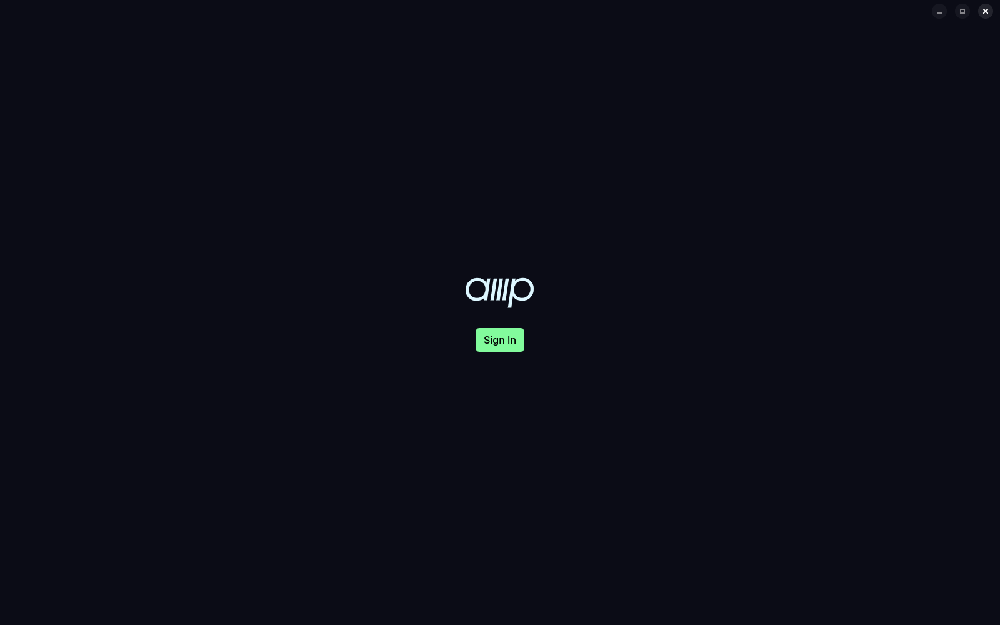
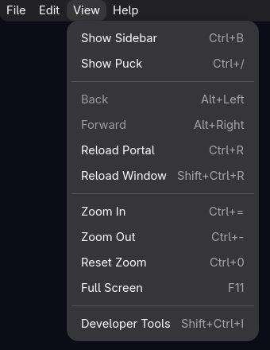

# Amp Linux Desktop

Amp Linux Desktop runs [Amp](https://ampcode.com) as a desktop app on Linux. Like Amp's macOS app,
it loads ampcode.com in a web view and answers the page's native bridge. The page then switches to
the layout it uses in the macOS app, and new Amp features arrive without an app update. The app
uses GTK 4, libadwaita, and WebKitGTK, and it takes its window controls, menus, and colours from
your desktop.



## What the app adds to ampcode.com in a browser

- Amp opens from the launcher in its own window. The launcher entry's right-click menu has
  **New Thread**, **Dictate New Thread**, and **Show Puck**.
- Press Alt to show a menu bar with the macOS app's commands, with Ctrl in place of Cmd. The
  shortcuts reach the app before the page. Ctrl+W closes the open pane tab before the window, and
  Ctrl+R reloads Amp, not a browser tab.
- `amp-linux-desktop --action NAME` runs a command in Amp from anywhere on the desktop. See
  [Bind desktop-wide shortcuts](#bind-desktop-wide-shortcuts).
- A tray icon lists your recent threads, marks the unread ones, and shows the unread count. It
  needs a StatusNotifierItem host, such as the tray of Waybar, KDE, or GNOME's AppIndicator
  extension.
- Threads from ampcode.com can run on this computer. Turn the runner on in **Preferences** →
  **Runner**.
- Local project import finds the Git checkouts that Claude Code, Codex, Cursor, and OpenCode worked
  in.
- A file in a thread opens in your editor or shows in your file manager.
- With **Appearance** set to **System**, the page takes its colours from the current Omarchy theme
  and follows each theme change.



## Parity with the macOS app

This table lists the features of Amp's macOS app and whether this app has them. A row says Yes
only with proof: a screenshot in `docs/img`, or Linux code that answers the same bridge message
or does the same job as the macOS reference. A row without proof says "Not verified".

The macOS references are class names, Info.plist keys, and strings in Amp's macOS disk image,
build 1125 (`https://static.ampcode.com/mac/Amp-1.0-1125.dmg`, 2026-11-06). The Linux code is in
`crates/app/src` unless the row names another crate.

| macOS app feature | Linux | Linux proof | macOS reference |
|---|---|---|---|
| ampcode.com in its desktop layout | Yes | [start screen](docs/img/start.png), `common/src/scripts.rs` `SHELL_MARKERS` | user script that sets `dataset.ampShell` |
| Menu bar with keyboard shortcuts and zoom | Yes: Amp, File, Edit, View, Window, and Help | [View menu](docs/img/menu.png), `menus.rs` `MENUS`, `App::handle_shortcut` | `MacWebCommandController`, `MacWebZoomController`, menu items `Personal Settings` and `Workspace Settings` |
| Settings window | Yes | [General](docs/img/settings.png), [Runner](docs/img/runner.png), `settings_window.rs` `SettingsWindow` | `MacAppSettingsMessageHandler`, `Warn Before Quitting`, `MacAppIconController` |
| Open at login | Not verified | `app.rs` `App::set_open_at_login` | `SMAppService` |
| More than one window | Not verified | `app.rs` `App::open_window` | `MacOpenWindowMessageHandler` |
| Puck, in the main window or its own window | Yes | `bridge.rs` handlers `ampNativeOpenPuckWindow`, `ampNativeTogglePuckWindow` | `NativeOpenPuckWindow`, `NativeTogglePuckWindow`, `PuckWindow` |
| Sign-in through the system browser | Yes | `signin.rs` `SignIn`, callback scheme `com.ampcode.amp.linux.auth` | Info.plist `CFBundleURLTypes`: `com.ampcode.amp.macos.auth`, `NativeAuthenticationMessageHandler` |
| Passkeys | Not verified | `window.rs` `AmpWindow::decide_policy` opens the page's **Open in Browser** in your browser | `NativePasskeyDiagnosticsMessageHandler` |
| Confirm your identity again for sensitive actions | Not verified | no `ampNativeSudoAuthenticated` handler | `ampNativeSudoAuthenticated`, `authenticateSudo` |
| Account switcher | Not verified. The page posts `ampNativeAccountSwitch` only on iOS; Add Another Account signs in through your browser. | `bridge.rs` handler `ampNativeAuthenticate`, `signin.rs` `SignIn::start` | `ampNativeAccountSwitch`, `NativeAuthenticationMessageHandler` |
| Copy to the clipboard | Yes | `bridge.rs` `write_clipboard` | `ampNativeClipboard`, `ampNativeClipboardWrite` |
| Paste images | Yes | `files.rs` `read_pasteboard_images` | `MacPasteboardImagesMessageHandler` |
| Native confirmation dialogs | Partial: protocol v2 (title, text, message, phrase, checkbox). Dialogs with choices or fields stay in the page. | `confirmation.rs` `ConfirmationSheet`, `common/src/scripts.rs` `SHELL_MARKERS` | `MacNativeConfirmationSheetWindow`, `ampNativeConfirmationAlert = 'v5'` |
| Native actions on selected transcript text | No | no `ampNativeTranscriptSelectionV2` handler | `ampNativeTranscriptSelectionV2` |
| Toasts | Yes | `toasts.rs` `ToastCenter` | `NativeToastMessageHandler` |
| Open a file in your editor | Yes | `files.rs` `open_in_editor` | `MacOpenInEditorMessageHandler` |
| Show a file in the file manager | Yes | `files.rs` `show_in_file_manager` | `MacShowInFinderMessageHandler` |
| Save files to Downloads | Yes | `files.rs` `save_file`, `save_stream` | `NativeSaveFileMessageHandler` |
| Drag files out of the page | Yes | `file_drag.rs` `handle` answers `ampNativeFileDrag` with a desktop drag of the file | `MacFileDragMessageHandler` |
| Print | Yes | `bridge.rs` `print_html` answers `ampNativePrint` with GTK's print dialog | `NativePrintMessageHandler` |
| Use this computer as a runner | Yes | [Runner settings](docs/img/runner.png), `runner.rs` `Runner` | `MacRunnerController`, `Use This Mac as a Runner` |
| Runner: share the display, terminal access, keep awake | Not verified | `runner.rs` `Runner` passes `--desktop` and `--remote-control-terminal` and runs under `systemd-inhibit` | `Share This Mac`, `Allow Terminal Access`, `MacKeepAwakeController` |
| Local project import | Partial: Claude Code, Codex, Cursor, and OpenCode. Grok is missing. | `local_projects.rs` `discover`, `choose_projects.rs` `show` | `MacImportLocalProjectsMessageHandler`, sources `claude-code`, `cursor`, `grok`, `opencode` |
| Thread import from other agents | Yes | `thread_import.rs` `show`, `ThreadImports` run `amp threads import` | `MacThreadImportController`, `Import Threads` |
| Dictation | Yes | `dictation` crate `Dictation` records with GStreamer | `NativeDictationMessageHandler` |
| Puck voice | Not verified | no `ampNativePuckVoice` handler. The page uses its own audio path. | `NativePuckVoiceMessageHandler`, `AmpPuckVoiceCore` |
| Huddles | Partial: no screen sharing and no transcription upload | `huddle` crate `HuddleWindow` joins the call through LiveKit's Rust SDK, because distribution WebKitGTK has no WebRTC | `WebRTC.framework`, Info.plist `NSCameraUsageDescription` |
| Menu bar extra | Yes, as a tray icon | `tray.rs` `Tray` (StatusNotifierItem) | `MacMenuBarController`, `NSStatusItem` |
| Global shortcuts | Yes, through compositor bindings | `menus.rs` `GLOBAL_COMMANDS`, `--action` | `MacGlobalHotKeyManager`, `MacGlobalShortcutsMessageHandler` |
| Notifications | Partial: only while Amp runs, and without action buttons. A click opens the thread. | `app.rs` `App::post_notification` | `MacLocalNotificationMessageHandler`, `UNNotificationCategory`, `registerForRemoteNotifications` |
| Unread count on the app icon | Partial: sent through the Unity LauncherEntry D-Bus API, which Omarchy does not show. The tray shows the count. | `app.rs` `App::refresh_badge` | `dockTile`, `unreadThreadCount` |
| Orb thread Desktop and Terminal tabs | Yes | `common/src/scripts.rs` `NO_WEBRTC` moves the page to its WebSocket transport, gst-libav decodes the video | `WebRTC.framework` |
| Orb thread Mac tab | Not verified | same viewer as the Desktop tab | `WebRTC.framework` |
| Web inspector | Yes | [View menu](docs/img/menu.png): **Developer Tools** | `MacWebInspectorMessageHandler` |
| Automatic updates | No. Your package manager updates the app, and the page is always the current ampcode.com. | none | `Sparkle.framework`, Info.plist `SUFeedURL` |
| Share extension | No | none | `PlugIns/AmpShareExtension.appex` |
| Shortcuts actions | No | none | `Metadata.appintents`: `CallPuckIntent`, `SendMessageToPuckIntent`, `TalkToPuckIntent` |

## Install

### Arch Linux

The package in `packaging/arch` installs the app for all users. It is not on the AUR yet, because
the AUR has paused new account registrations. Until it is, build and install it from this
repository:

```sh
git clone https://github.com/5omeOtherGuy/amp-linux-desktop.git
cd amp-linux-desktop/packaging/arch
makepkg -si
```

`makepkg -s` installs the build and runtime dependencies with pacman first, and `-i` installs the
package. The PKGBUILD builds the release tag, not your checkout.

The package builds Amp's app icons from Amp's macOS disk image, because they are Amp's artwork and
this repository does not carry them. Optional packages add features:

| Package | Adds |
|---|---|
| `gst-plugins-base`, `gst-plugins-good` | dictation and the Huddle camera |
| `gst-libav` | the video in an orb thread's Desktop and Mac tabs |
| `ampcode` (AUR) | the Amp CLI for the runner. Without it, Amp installs the CLI when you turn the runner on. |

If you installed with `scripts/install` before, delete `~/.local/bin/amp-linux-desktop` and
`~/.local/share/applications/dev.ampnative.Amp.desktop`. Otherwise they take precedence over the
package.

### Debian and Ubuntu

Debian 13 and Ubuntu 24.04 or later have the WebKitGTK 6.0 the app needs. Download the `.deb` from
the [latest release](https://github.com/5omeOtherGuy/amp-linux-desktop/releases/latest) and
install it with its dependencies:

```sh
sudo apt install ./amp-linux-desktop_*_amd64.deb
```

The `.deb` does not update itself; install the next release's `.deb` the same way.

### Fedora

```sh
sudo dnf copr enable 5omeotherguy/amp-linux-desktop
sudo dnf install amp-linux-desktop
```

`dnf upgrade` then keeps the app current.

### Amp's icons and orb video on Debian, Ubuntu, and Fedora

- The `.deb` and the `.rpm` do not contain Amp's icons. On the first start the app downloads Amp's
  macOS disk image (13 MB) once and extracts them with 7-Zip. Until then, the launcher shows a
  generic icon.
- The video in an orb thread's Desktop and Mac tabs needs an H.264 decoder: `gstreamer1.0-libav`
  on Debian and Ubuntu (recommended by the `.deb`), `gstreamer1-plugin-openh264` on Fedora
  (recommended by the `.rpm`).

### Any distribution, from a checkout

`scripts/install` builds the app from a checkout and installs it for your user. It needs a Rust
toolchain (cargo), clang, the headers of GTK 4, libadwaita 1.2 or later, WebKitGTK 6.0, GStreamer and
libsoup 3, and 7-Zip to extract the icons:

- Debian and Ubuntu: `apt install cargo clang libgtk-4-dev libadwaita-1-dev libwebkitgtk-6.0-dev
  libgstreamer-plugins-base1.0-dev libsoup-3.0-dev libsqlite3-dev gstreamer1.0-libav 7zip`. The app
  needs Rust 1.96 or later; if your distribution's is older, install Rust with
  [rustup](https://rustup.rs).
- Arch: `pacman -S rust clang gtk4 libadwaita webkitgtk-6.0 gst-plugins-base-libs gst-libav 7zip`

```sh
scripts/install
```

The script builds the release binary, copies it to `~/.local/bin/amp-linux-desktop`, and adds the
desktop entry (which also receives the sign-in callback) and Amp's icons. The first build downloads
LiveKit's prebuilt WebRTC library for Huddles (156 MB). Dictation and the Huddle camera also need
GStreamer's base and good plugins.

## Bind desktop-wide shortcuts

`amp-linux-desktop --action NAME` runs an action in the running app, or starts the app first. The
names are `show`, `new-thread`, `dictate-new-thread`, `toggle-puck`, and `puck-voice`. Bind them in
your compositor. For Hyprland:

```ini
bind = SUPER SHIFT, N, exec, amp-linux-desktop --action new-thread
bind = SUPER, slash, exec, amp-linux-desktop --action toggle-puck
```

## Development

`cargo run` builds and runs the app from a checkout. With `AMP_NATIVE_DEBUG=1`, the app logs every
bridge message to `~/.cache/amp-native/amp-native.log`. The scripts in `dev/` run only inside an
Amp orb's Desktop. `packaging/arch` holds the AUR package, `packaging/debian/build-deb` builds the
`.deb`, and `packaging/fedora` holds the COPR spec file. [`CHANGELOG.md`](CHANGELOG.md) lists the
changes in each release.

## License

MIT, see [LICENSE](LICENSE). Amp, its name and its icons belong to Amp; the repository carries none
of Amp's artwork. The Arch package extracts the icons from Amp's own macOS disk image when it builds;
the other packages fetch them on first start.
